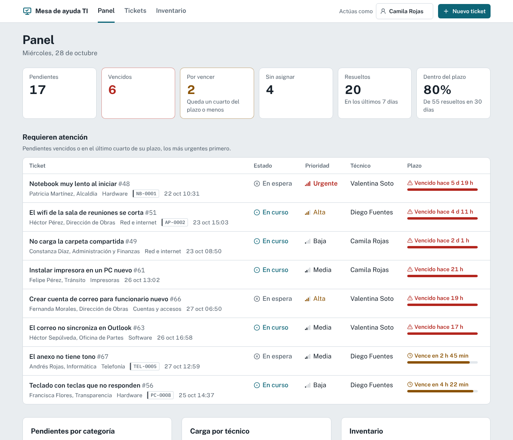
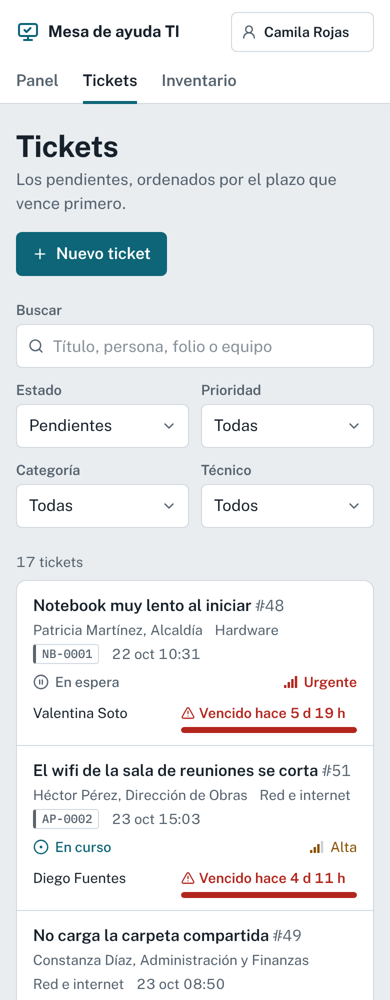
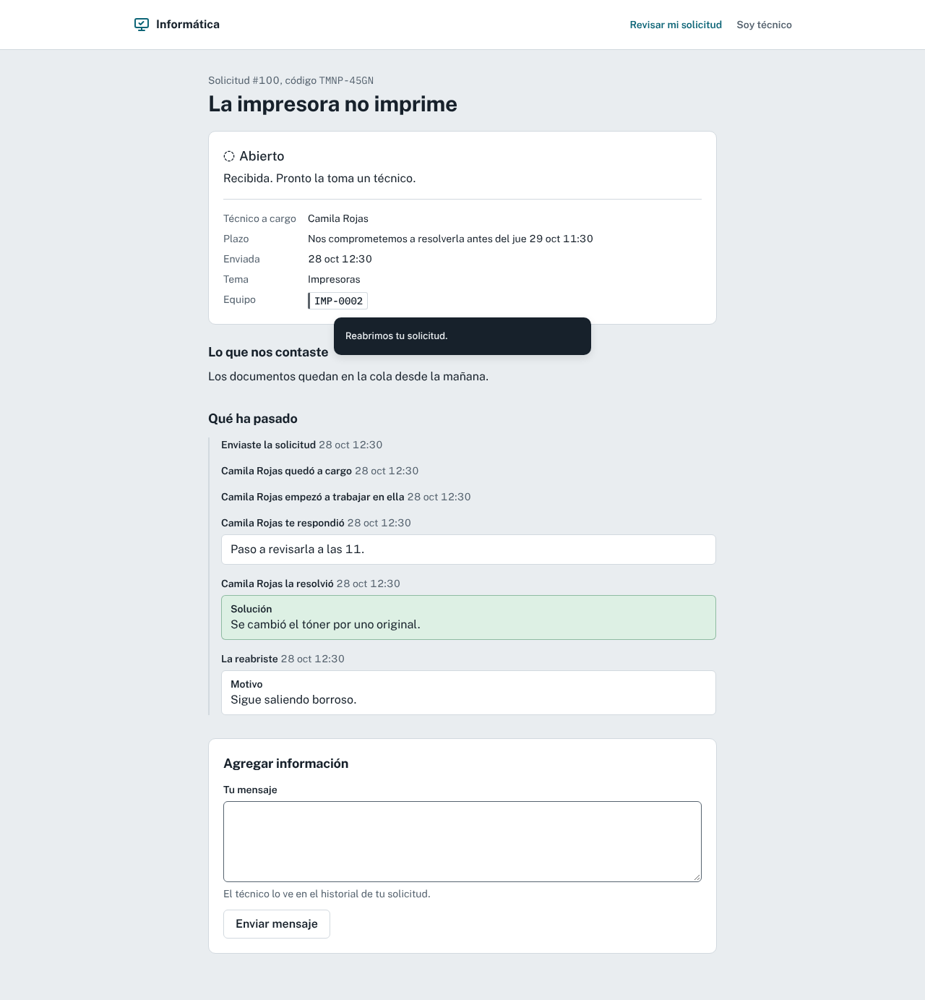
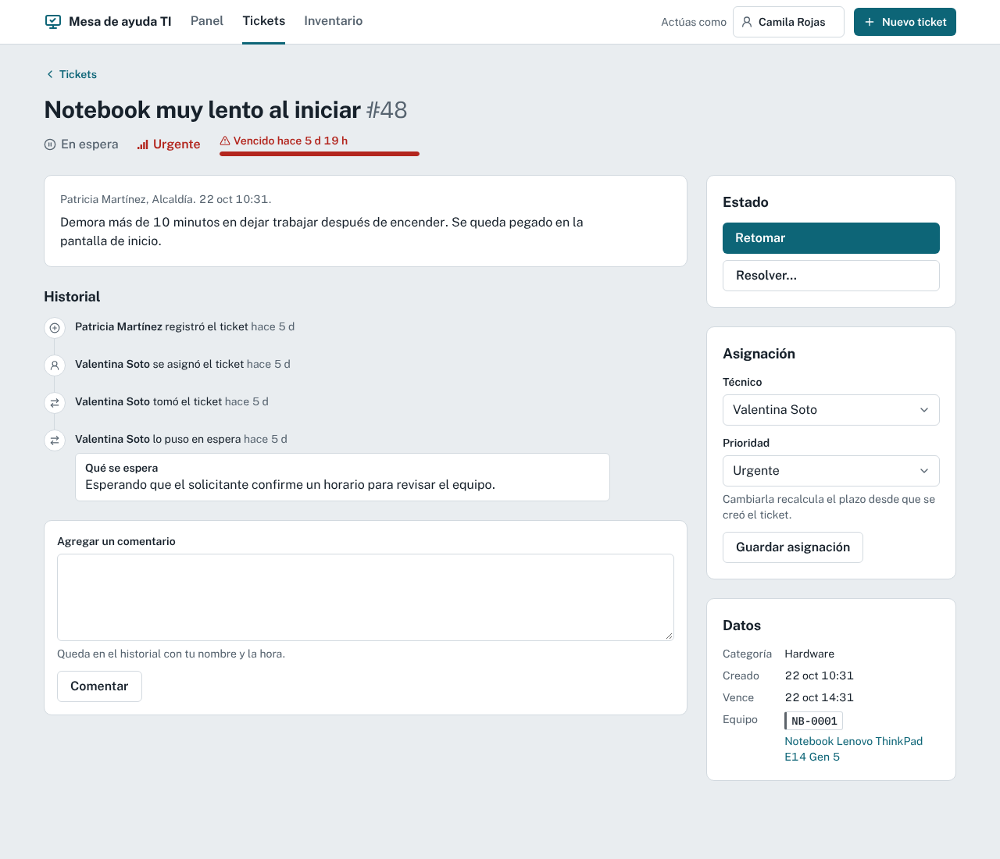

# Mesa de ayuda TI

[](https://github.com/gadiiiiii/mesa-ayuda-ti/actions/workflows/ci.yml)

Mesa de ayuda e inventario de equipos para el soporte informático de una oficina municipal. Se registran los tickets, cada uno con un **plazo según su prioridad**, y se asocian a los equipos del inventario para ver el historial de fallas de cada uno.

**Demo: [mesa-ayuda-ti.vercel.app](https://mesa-ayuda-ti.vercel.app)**. Es pública: no tiene inicio de sesión, los datos son inventados y cualquiera puede volver a los datos de ejemplo desde el panel.

<p>
  
  
</p>

## Qué hace

### Tickets con plazo

Cada ticket tiene un plazo en **horas hábiles** que depende de su prioridad:

| Prioridad | Cuándo | Plazo |
|---|---|---|
| Urgente | Detiene la atención de público o a toda una unidad | 4 horas hábiles |
| Alta | Una persona no puede trabajar | 8 horas hábiles (cerca de un día) |
| Media | Se puede trabajar, pero con dificultad | 16 horas hábiles (cerca de dos días) |
| Baja | Consultas, instalaciones y mejoras | 40 horas hábiles (cerca de una semana) |

El plazo corre solo en horario de oficina (lunes a jueves de 8:30 a 17:30 y viernes de 8:30 a 16:30), salta fines de semana y feriados nacionales de Chile, y **se detiene mientras el ticket está en espera** (por un repuesto, el proveedor o el solicitante). Un ticket que llega a las 17:00 de un viernes no se vence el fin de semana.

Una **barra de plazo** muestra cuánto se ha consumido: gris a tiempo, ámbar en el último cuarto, roja cuando se venció y apagada mientras está en pausa. Al resolverse, el ticket queda marcado como resuelto dentro o fuera de plazo. Cambiar la prioridad recalcula el plazo desde que se creó el ticket.

### Estados

```
Abierto ──Tomar──▶ En curso ──Resolver──▶ Resuelto ──Cerrar──▶ Cerrado
   │                 │  ▲                     │                   │
   │          Poner en espera / Retomar       └──── Reabrir ◀─────┘
   └── Resolver, poner en espera o cerrar sin resolver
```

Resolver pide la solución, poner en espera pide qué se espera, y cerrar sin resolver o reabrir piden el motivo. Quien toma un ticket sin técnico queda asignado. Todo queda en el **historial** del ticket, con autor y hora, junto a los comentarios.

### Portal de solicitudes

En [`/portal`](https://mesa-ayuda-ti.vercel.app/portal) cualquier funcionario pide ayuda sin cuenta: su nombre, su unidad, qué pasa y **cuánto le afecta** (no elige la prioridad: la prioridad sale del impacto, como en ITIL, y el técnico la puede ajustar). Si el problema es de un equipo, escribe el código de su etiqueta (`NB-0007`).

Al enviar recibe un **código de seguimiento** (`ABCD-2345`, sin letras ni números que se confundan) para ver en qué va su solicitud: estado explicado en palabras simples, técnico a cargo, plazo comprometido e historial. Puede agregar información y, si el ticket estaba resuelto pero el problema sigue, reabrirlo.

Los técnicos eligen en cada comentario si es una **nota interna** o una **respuesta que ve el solicitante**; el portal nunca muestra notas internas ni cambios de prioridad.



### Mis tickets y asignación automática

**Mis tickets** reúne lo que tiene asignado el técnico (los que vencen antes, primero), los pendientes sin técnico que puede tomar y lo que resolvió en la semana. La barra superior muestra cuántos pendientes tiene.

Cada categoría tiene una **regla de asignación** para los tickets nuevos, vengan de la mesa o del portal: dejarlos en la cola, darlos siempre a un especialista (por ejemplo, redes y telefonía a Diego) o al técnico disponible con menos pendientes. Quien está de vacaciones o con licencia se marca como no disponible: no recibe tickets nuevos y los de su especialidad se reparten entre los demás. El historial muestra «Se asignó automáticamente a…».

### Inventario

Equipos con código de inventario correlativo por tipo (`NB-0007`, `IMP-0012`, `SW-0002`…), marca, modelo, serie, unidad, responsable, estado (en uso, en bodega, en reparación, de baja), IP y MAC. La IP y la MAC se validan y se normalizan: la MAC se acepta con dos puntos, guiones o en formato Cisco (`001a.2b3c.4d5e`). La ficha de cada equipo muestra todos sus tickets y permite crear uno nuevo ya asociado.

### Panel

Pendientes, vencidos, por vencer, sin asignar, resueltos en la semana y el porcentaje resuelto dentro del plazo en los últimos 30 días. Debajo, los tickets que requieren atención y gráficos de pendientes por categoría, carga por técnico y estado del inventario.

### Sin inicio de sesión

Arriba a la derecha se elige **como qué técnico actúas** (se guarda en una cookie). Ese nombre queda en el historial de lo que hagas.



## Cómo está hecho

- [Next.js](https://nextjs.org) (App Router, Server Components y Server Actions) + TypeScript.
- **Postgres** con [Drizzle ORM](https://orm.drizzle.team):
  - En producción, [Neon](https://neon.tech) (Postgres serverless) a través de la variable `DATABASE_URL`.
  - En desarrollo y en los tests, [PGlite](https://pglite.dev): el mismo Postgres compilado a WebAssembly, sin instalar nada. Se guarda en `.pglite/` o en memoria.
  - Migraciones SQL en [`drizzle/`](drizzle), generadas desde el esquema ([`lib/db/esquema.ts`](lib/db/esquema.ts)). Antes de cada `dev` y `build` se aplican las pendientes y, si la base está vacía, se cargan los datos de ejemplo ([`scripts/preparar-db.ts`](scripts/preparar-db.ts)).
- Validación de formularios con [Zod](https://zod.dev); los errores se muestran en cada campo y no se pierde lo escrito.
- Tailwind CSS v4 y componentes con la estructura de shadcn/ui (Radix UI). Sistema de diseño en [`DESIGN.md`](DESIGN.md).
- Fechas siempre en hora de Chile, aunque el servidor corra en UTC.
- Accesibilidad: auditada con axe-core (WCAG 2.1 AA, modo claro y oscuro, sin infracciones), navegable con teclado, selects nativos en el celular y los estados nunca se distinguen solo por color.
- La lógica está separada de la interfaz:
  - [`lib/dominio.ts`](lib/dominio.ts): estados y cambios permitidos, plazos, códigos de inventario.
  - [`lib/horario.ts`](lib/horario.ts): tiempo hábil en la hora de Chile (con su cambio de horario), con los feriados de [`lib/feriados.ts`](lib/feriados.ts).
  - [`lib/datos.ts`](lib/datos.ts): consultas y cambios en la base, cada cambio de estado en una transacción junto a su registro en el historial.
  - [`lib/semilla.ts`](lib/semilla.ts): datos de ejemplo reproducibles, con fechas relativas a hoy.
- **Tests con [Vitest](https://vitest.dev)**, contra un Postgres real en memoria (PGlite): ciclo de vida completo de un ticket, cambios no permitidos, filtros y búsqueda, códigos de inventario y datos de ejemplo. El calendario hábil se prueba con viernes, fines de semana, Navidad, cambio de horario y la ida y vuelta entre sumar y medir tiempo hábil.
- GitHub Actions corre los tests y el build en cada push.

## Desarrollo local

```bash
npm install
npm run dev      # http://localhost:3000, con una base PGlite en .pglite/
npm test
npm run build
```

Para cambiar el esquema: edita `lib/db/esquema.ts` y genera la migración con `npm run db:generar`.

## Despliegue en Vercel

1. Importa el repositorio en Vercel.
2. En la pestaña **Storage** del proyecto, crea una base **Neon** (plan gratuito) y conéctala al proyecto con **Connect Project**. Vercel agrega las variables `DATABASE_URL` y `DATABASE_URL_UNPOOLED`.
3. Vuelve a desplegar. El build aplica las migraciones y carga los datos de ejemplo.

## Hoja de ruta

- [x] Tickets con plazos, historial y asignación; inventario; panel; demo pública con datos de ejemplo.
- [x] Plazos en horas hábiles, con feriados y pausa mientras el ticket está en espera.
- [x] Portal para que cualquier funcionario pida ayuda y siga su ticket con un código.
- [x] «Mis tickets» y asignación automática por categoría, carga y disponibilidad.
- [ ] Tickets relacionados: duplicados y problemas que agrupan varios tickets.
- [ ] Base de conocimiento y respuestas predefinidas.
- [ ] Métricas de tiempos y encuesta de satisfacción.
- [ ] Inventario con garantía, historial de cambios y mantenciones.
- [ ] Inicio de sesión con roles (quien pide ayuda y técnico).
- [ ] Avisos por correo al solicitante cuando su ticket se resuelve.
- [ ] Adjuntar capturas de pantalla a un ticket.

## Licencia

MIT — Gadiel Vega Salgado
